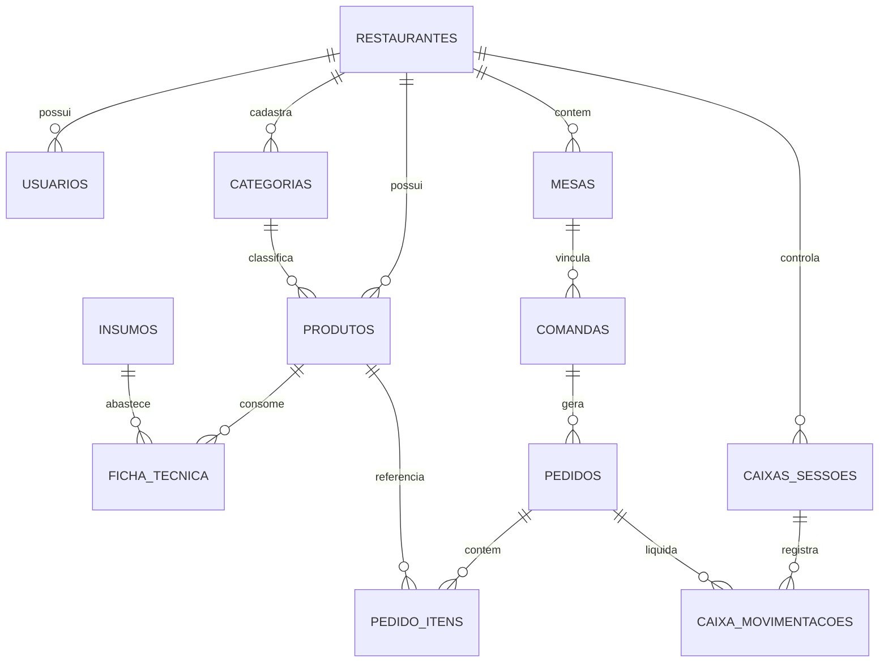

# 🗄️ Modelagem do Banco de Dados: EloServe PDV

A modelagem foi concebida utilizando o **PostgreSQL 16** (com suporte ao **Supabase**), preparada para arquitetura **Multi-Tenant** (onde múltiplos restaurantes operam no mesmo banco com segurança e isolamento por `restaurante_id`).

---

## 1. Diagrama Entidade-Relacionamento (Conceitual)



---

## 2. DDL das Tabelas Principais (SQL Schema)

### A. Núcleo Multi-Tenant & Usuários

```sql
-- 1. Tabela de Restaurantes (Tenants)
CREATE TABLE public.restaurantes (
    id UUID PRIMARY KEY DEFAULT gen_random_uuid(),
    nome_fantasia TEXT NOT NULL,
    razao_social TEXT,
    cnpj TEXT UNIQUE,
    telefone TEXT,
    email TEXT UNIQUE NOT NULL,
    endereco TEXT,
    cidade TEXT,
    uf VARCHAR(2),
    logo_url TEXT,
    chave_pix TEXT,
    tipo_chave_pix TEXT, -- 'CPF', 'CNPJ', 'EMAIL', 'TELEFONE', 'ALEATORIA'
    taxa_servico_padrao NUMERIC(5,2) DEFAULT 10.00,
    ativo BOOLEAN DEFAULT true,
    criado_em TIMESTAMPTZ DEFAULT now(),
    atualizado_em TIMESTAMPTZ DEFAULT now()
);

-- 2. Tabela de Usuários / Operadores
CREATE TABLE public.usuarios (
    id UUID PRIMARY KEY DEFAULT gen_random_uuid(),
    restaurante_id UUID NOT NULL REFERENCES public.restaurantes(id) ON DELETE CASCADE,
    nome TEXT NOT NULL,
    email TEXT NOT NULL,
    perfil TEXT NOT NULL DEFAULT 'atendente', -- 'admin', 'gerente', 'caixa', 'garcom', 'cozinha'
    pin_seguranca VARCHAR(6), -- PIN de 4 a 6 dígitos para troca rápida de operador no caixa
    ativo BOOLEAN DEFAULT true,
    criado_em TIMESTAMPTZ DEFAULT now()
);
```

---

### B. Cardápio, Categorias & Ficha Técnica

```sql
-- 3. Categorias do Cardápio
CREATE TABLE public.categorias (
    id UUID PRIMARY KEY DEFAULT gen_random_uuid(),
    restaurante_id UUID NOT NULL REFERENCES public.restaurantes(id) ON DELETE CASCADE,
    nome TEXT NOT NULL, -- 'Lanches', 'Pizzas', 'Bebidas', 'Sobremesas'
    ordem_exibicao INTEGER DEFAULT 0,
    icone TEXT,
    ativo BOOLEAN DEFAULT true
);

-- 4. Produtos à Venda
CREATE TABLE public.produtos (
    id UUID PRIMARY KEY DEFAULT gen_random_uuid(),
    restaurante_id UUID NOT NULL REFERENCES public.restaurantes(id) ON DELETE CASCADE,
    categoria_id UUID REFERENCES public.categorias(id) ON DELETE SET NULL,
    nome TEXT NOT NULL,
    descricao TEXT,
    preco_venda NUMERIC(10,2) NOT NULL,
    preco_custo NUMERIC(10,2) DEFAULT 0.00,
    foto_url TEXT,
    codigo_barras TEXT,
    imprime_setor TEXT DEFAULT 'cozinha', -- 'cozinha', 'bar', 'nenhum'
    disponivel BOOLEAN DEFAULT true,
    destaque BOOLEAN DEFAULT false,
    criado_em TIMESTAMPTZ DEFAULT now()
);

-- 5. Insumos do Estoque (Matéria-prima)
CREATE TABLE public.insumos (
    id UUID PRIMARY KEY DEFAULT gen_random_uuid(),
    restaurante_id UUID NOT NULL REFERENCES public.restaurantes(id) ON DELETE CASCADE,
    nome TEXT NOT NULL, -- 'Carne Moída Blend', 'Queijo Mussarela', 'Pão Brioche'
    unidade_medida TEXT NOT NULL, -- 'kg', 'g', 'l', 'ml', 'un'
    quantidade_atual NUMERIC(12,3) NOT NULL DEFAULT 0.000,
    estoque_minimo NUMERIC(12,3) DEFAULT 0.000,
    custo_unitario NUMERIC(10,2) DEFAULT 0.00
);

-- 6. Ficha Técnica (Engenharia de Cardápio / Baixa automática)
CREATE TABLE public.ficha_tecnica (
    id UUID PRIMARY KEY DEFAULT gen_random_uuid(),
    produto_id UUID NOT NULL REFERENCES public.produtos(id) ON DELETE CASCADE,
    insumo_id UUID NOT NULL REFERENCES public.insumos(id) ON DELETE CASCADE,
    quantidade_gasta NUMERIC(12,3) NOT NULL -- Quanto desconta por produto vendido
);
```

---

### C. Mesas, Comandas, Pedidos & KDS

```sql
-- 7. Mesas do Salão
CREATE TABLE public.mesas (
    id UUID PRIMARY KEY DEFAULT gen_random_uuid(),
    restaurante_id UUID NOT NULL REFERENCES public.restaurantes(id) ON DELETE CASCADE,
    numero INTEGER NOT NULL,
    capacidade INTEGER DEFAULT 4,
    setor TEXT DEFAULT 'Salão Principal',
    status TEXT DEFAULT 'livre', -- 'livre', 'ocupada', 'aguardando_pagamento', 'chamar_garcom'
    qr_token TEXT UNIQUE NOT NULL -- Token único para o QR Code da mesa
);

-- 8. Comandas (Sessão de Consumo da Mesa ou Avulsa)
CREATE TABLE public.comandas (
    id UUID PRIMARY KEY DEFAULT gen_random_uuid(),
    restaurante_id UUID NOT NULL REFERENCES public.restaurantes(id) ON DELETE CASCADE,
    mesa_id UUID REFERENCES public.mesas(id) ON DELETE SET NULL,
    numero_comanda TEXT,
    nome_cliente TEXT,
    status TEXT DEFAULT 'aberta', -- 'aberta', 'fechada', 'cancelada'
    total_bruto NUMERIC(10,2) DEFAULT 0.00,
    desconto NUMERIC(10,2) DEFAULT 0.00,
    taxa_servico NUMERIC(10,2) DEFAULT 0.00,
    total_liquido NUMERIC(10,2) DEFAULT 0.00,
    aberta_em TIMESTAMPTZ DEFAULT now(),
    fechada_em TIMESTAMPTZ
);

-- 9. Pedidos
CREATE TABLE public.pedidos (
    id UUID PRIMARY KEY DEFAULT gen_random_uuid(),
    restaurante_id UUID NOT NULL REFERENCES public.restaurantes(id) ON DELETE CASCADE,
    comanda_id UUID REFERENCES public.comandas(id) ON DELETE CASCADE,
    tipo_pedido TEXT NOT NULL DEFAULT 'mesa', -- 'mesa', 'balcao', 'delivery'
    status_producao TEXT DEFAULT 'novo', -- 'novo', 'em_preparo', 'pronto', 'entregue'
    tempo_inicio_preparo TIMESTAMPTZ,
    tempo_pronto TIMESTAMPTZ,
    origem TEXT DEFAULT 'garcom', -- 'garcom', 'qr_mesa', 'balcao', 'whatsapp'
    observacoes TEXT,
    criado_em TIMESTAMPTZ DEFAULT now()
);

-- 10. Itens do Pedido
CREATE TABLE public.pedido_itens (
    id UUID PRIMARY KEY DEFAULT gen_random_uuid(),
    pedido_id UUID NOT NULL REFERENCES public.pedidos(id) ON DELETE CASCADE,
    produto_id UUID NOT NULL REFERENCES public.produtos(id),
    quantidade NUMERIC(8,2) NOT NULL DEFAULT 1,
    preco_unitario NUMERIC(10,2) NOT NULL,
    subtotal NUMERIC(10,2) NOT NULL,
    observacoes_item TEXT, -- Ex: 'sem cebola, bem passado'
    status_item TEXT DEFAULT 'aguardando' -- 'aguardando', 'preparando', 'concluido'
);
```

---

### D. Controle Financeiro & Fechamento de Caixa

```sql
-- 11. Sessões de Caixa (Turnos)
CREATE TABLE public.caixas_sessoes (
    id UUID PRIMARY KEY DEFAULT gen_random_uuid(),
    restaurante_id UUID NOT NULL REFERENCES public.restaurantes(id) ON DELETE CASCADE,
    usuario_abertura_id UUID REFERENCES public.usuarios(id),
    usuario_fechamento_id UUID REFERENCES public.usuarios(id),
    saldo_inicial NUMERIC(10,2) NOT NULL DEFAULT 0.00, -- Suprimento
    total_dinheiro NUMERIC(10,2) DEFAULT 0.00,
    total_pix NUMERIC(10,2) DEFAULT 0.00,
    total_cartao_credito NUMERIC(10,2) DEFAULT 0.00,
    total_cartao_debito NUMERIC(10,2) DEFAULT 0.00,
    total_outros NUMERIC(10,2) DEFAULT 0.00,
    total_sangrias NUMERIC(10,2) DEFAULT 0.00,
    saldo_apurado_operador NUMERIC(10,2), -- O valor físico contado no fechamento cego
    diferenca_caixa NUMERIC(10,2), -- Sobra (+) ou Quebra (-)
    status TEXT DEFAULT 'aberto', -- 'aberto', 'fechado'
    aberto_em TIMESTAMPTZ DEFAULT now(),
    fechado_em TIMESTAMPTZ
);

-- 12. Movimentações Detalhadas do Caixa
CREATE TABLE public.caixa_movimentacoes (
    id UUID PRIMARY KEY DEFAULT gen_random_uuid(),
    caixa_sessao_id UUID NOT NULL REFERENCES public.caixas_sessoes(id) ON DELETE CASCADE,
    pedido_id UUID REFERENCES public.pedidos(id),
    tipo_movimento TEXT NOT NULL, -- 'venda', 'sangria', 'suprimento', 'estorno'
    forma_pagamento TEXT NOT NULL, -- 'dinheiro', 'pix', 'credito', 'debito', 'voucher'
    valor NUMERIC(10,2) NOT NULL,
    motivo_justificativa TEXT,
    criado_em TIMESTAMPTZ DEFAULT now()
);
```
